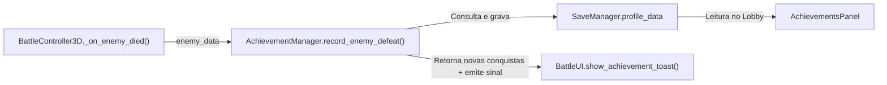

# Sistema de Conquistas — RogueRPG

Documento técnico explicando a arquitetura, o funcionamento interno, o histórico de implementação e como modificar ou expandir o sistema de conquistas do projeto **RogueRPG**.

---

## 1. Visão Geral e Como Funciona

O sistema de conquistas registra marcos permanentes por perfil de jogador — iniciando pelo rastreamento dos **Inimigos Elite** já derrotados (`Lobisomem Alfa`, `Górgona`, `Yamabushi Tengu`, `Karasu Tengu` e a conquista meta `Lenda dos Elites`).

### Fluxo completo em tempo de execução



1. **Combate (`BattleController3D`)**: ao derrotar um inimigo com `enemy_data.is_elite == true`, `_on_enemy_died()` chama `AchievementManager.record_enemy_defeat(enemy_node.enemy_data)`.
2. **Avaliação (`AchievementManager`)**:
   - Registra `enemy_data.id` na lista `defeated_elites` do perfil ativo (sem duplicatas).
   - Percorre todas as conquistas cadastradas que ainda não estão desbloqueadas e verifica se a regra da conquista foi satisfeita (`elite_defeat` ou `all_elites`).
   - Caso haja mudanças, persiste imediatamente via `SaveManager.save_achievements(...)`.
   - Emite `achievement_unlocked(achievement)` e retorna o array de conquistas recém-desbloqueadas.
3. **Feedback imediato (`BattleUI`)**: para cada conquista recém-desbloqueada, exibe um toast animado no canto superior direito (`show_achievement_toast`) com som de confirmação e registra a mensagem no histórico da batalha.
4. **Consulta no Lobby (`AchievementsPanel`)**: acessível pelo botão **Conquistas** na barra superior do Lobby (`LobbyController3D`), exibe o progresso `CONQUISTAS (X / Y)` e a lista completa com status `CONCLUÍDA` ou `BLOQUEADA`.

---

## 2. Como Foi Desenvolvido (Arquitetura e Padrões do Projeto)

O sistema foi desenhado seguindo exatamente a convenção arquitetural já usada no RogueRPG (`Resource` de dados + `Autoload` global + persistência validada no `SaveManager` + interface estilizada com `adventure_theme.tres`):

| Camada | Arquivo | Responsabilidade |
| :--- | :--- | :--- |
| **Modelo de Dados** | `Scripts/resources/achievement_data.gd` | `Resource` (`class_name AchievementData`) com `id`, `title`, `description`, `category`, `target_id`, `required_count` e `icon`. |
| **Catálogo `.tres`** | `Scripts/resources/Achievements/*.tres` | Definição declarativa de cada conquista (editável no Inspector do Godot). |
| **Autoload Global** | `Scripts/globals/achievement_manager.gd` | Singleton `AchievementManager` registrado em `project.godot`. Carrega o catálogo, avalia regras e dispara sinais. |
| **Persistência** | `Scripts/globals/save_manager.gd` | Armazena `unlocked_achievements` e `defeated_elites` dentro de `profile_data`, com validação em `_valid_profile_data()` e compatibilidade com saves antigos. |
| **UI de Consulta** | `Scenes/ui/achievements_panel.tscn` e `Scripts/ui/achievements_panel.gd` | Modal reutilizável para exibir progresso e status de cada conquista. |
| **Integrações** | `Scenes/3D/battle_controller_3d.gd`, `Scenes/battle/battle_ui.gd`, `Scenes/3D/Scripts/lobby_3d.gd` | Disparo no fim do combate, toast em batalha e botão no Lobby. |

### Decisões técnicas importantes
- **Persistência independente do Permadeath**: `unlocked_achievements` e `defeated_elites` vivem no perfil (`profile_data`) e **não** são apagados em `SaveManager.clear_active_run()`. Se o personagem morrer, o registro dos Elites já derrotados continua salvo no perfil.
- **Compatibilidade com builds exportados (`.pck`)**: em vez de varrer diretórios com `DirAccess.get_files_at("res://...")` (que pode falhar em exports devido a arquivos `.remap`), o `AchievementManager` usa a constante explícita `ACHIEVEMENT_PATHS`.
- **Retrocompatibilidade de saves**: perfis antigos sem as chaves `unlocked_achievements` ou `defeated_elites` recebem arrays vazios automaticamente pelo `candidate.merge(data, true)` em `SaveManager.load_profile()`.

---

## 3. Como Modificar e Expandir

### 3.1. Adicionar uma conquista para um novo Inimigo Elite
1. Crie o novo recurso `EnemyData` em `Scripts/resources/` com `is_elite = true` e um `id` único (ex.: `id = &"elite_dragon"`).
2. Crie um novo arquivo `.tres` em `Scripts/resources/Achievements/elite_dragon.tres`:
   ```ini
   [gd_resource type="Resource" script_class="AchievementData" format=3]

   [ext_resource type="Script" path="res://Scripts/resources/achievement_data.gd" id="1_ach"]

   [resource]
   script = ExtResource("1_ach")
   id = &"ach_elite_dragon"
   title = "Matador de Dragões"
   description = "Derrote o inimigo Elite Dragão Ancião."
   category = "elite_defeat"
   target_id = &"elite_dragon"
   required_count = 1
   ```
3. Adicione o caminho `"res://Scripts/resources/Achievements/elite_dragon.tres"` à constante `ACHIEVEMENT_PATHS` em `Scripts/globals/achievement_manager.gd`.
4. Se quiser que `all_elites.tres` exija também o novo Elite, atualize `required_count` em `Scripts/resources/Achievements/all_elites.tres`.

### 3.2. Adicionar novas categorias de conquistas (ex.: nível, moedas, vitórias)
1. **No recurso** (`Scripts/resources/achievement_data.gd`): adicione o novo valor ao `@export_enum` de `category` (por exemplo, `"level_reached"`, `"encounters_won"`).
2. **No gerenciador** (`Scripts/globals/achievement_manager.gd`): crie um método semântico seguindo o padrão existente, por exemplo:
   ```gdscript
   func record_level_reached(new_level: int) -> Array[AchievementData]:
       var newly_unlocked: Array[AchievementData] = []
       for ach in _achievements:
           if ach.category == "level_reached" and new_level >= ach.required_count:
               if unlock(ach.id):
                   newly_unlocked.append(ach)
       return newly_unlocked
   ```
3. **No ponto de disparo** (ex.: `BattleController3D._on_player_level_up` ou `SaveManager.add_coins`): chame o novo método do `AchievementManager` e encaminhe as conquistas retornadas para `ui.show_achievement_toast(ach)`.

### 3.3. Adicionar recompensas futuras ao desbloquear conquistas
- Adicione campos opcionais em `AchievementData` (ex.: `@export var reward_coins: int = 0` ou `@export var reward_item: ItemData`).
- No `AchievementManager`, ao confirmar um novo desbloqueio, aplique a recompensa (ex.: `SaveManager.add_coins(ach.reward_coins)` ou `SaveManager.add_to_stash(ach.reward_item)`) antes de emitir `achievement_unlocked`.
- Atualize `_build_card()` em `Scripts/ui/achievements_panel.gd` para exibir o ícone (`ach.icon`) ou o texto da recompensa no card da conquista.
